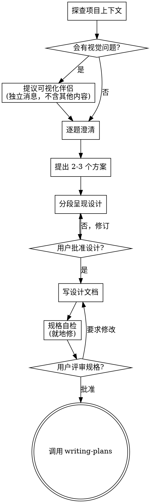

# 设计流程：把想法变成可落地的设计与规格

通过自然对话把想法推进成完整设计和规格：先理解项目上下文，再逐题澄清，理解清楚后给出设计并获批。

## 硬门禁（HARD-GATE）

**在触发范围内**（见下），在把设计呈现给用户并获批之前：

> 不要调用任何实现型 skill、不要写任何代码、不要搭任何脚手架、不要采取任何实现动作。

**触发范围**：全新功能、新组件/子系统、新 UI 界面、产品级行为设计。与感知到的复杂度无关——每个项目都走这个流程。

### 不触发门禁的情况（直接做，不要拦）

门禁防的是「做错东西」，不是「做小的可逆编辑」。以下情形跳过设计评审：

- **修 bug / 回归修复 /「让 X 按文档工作」**——需求已经存在。
- **重构、代码风格、配置改动**——包括被仓库 `AGENTS.md`、`CODE_WIKI.md` 或 CI 门禁强制要求的改动。
- **正在执行一个已获批的计划**——批量连续作业（如「按 P5→P4→… 依次落地，最后跑门禁」）不得逐项重新门禁。
- **用户正对着真实输出迭代**（日志、测试失败、真机验证）并要求再来一轮——他的请求本身就是下一轮的批准。

这些情况在回复里写一句「我将改什么、为什么」即可。但两条原则在任何场景都成立：**陈述你的假设，不要发明需求**。

### 反模式：「这太简单了，不用设计」

每个项目都走这个流程——待办清单、单函数工具、配置改动，全都算。「简单」的项目恰恰是未经检验的假设造成最多返工的地方。设计可以很短（真正简单时几句话就够），但**必须呈现并获批**。

## 检查清单（按顺序逐项完成）

1. **探查项目上下文**——文件、文档、近期提交。
2. **提议可视化伴侣**（若后续会涉及视觉问题）——**必须单独成一条消息**，不要和澄清问题合并，见 `visual-companion.md`。
3. **逐题澄清**——一次一题，搞清目的 / 约束 / 成功标准。
4. **提出 2-3 个方案**——带权衡与推荐。
5. **分段呈现设计**——按复杂度伸缩，每段讲完确认一次。
6. **写设计文档**——落盘并 commit。
7. **规格自检**——就地修正占位符、矛盾、歧义、范围问题。
8. **用户评审规格**——请用户过一遍再继续。
9. **转入实现**——调用 `writing-plans` 产出实现计划。

## 流程

**终态是调用 `writing-plans`。** 不要接着调用 frontend-design、mcp-builder 或其他实现型 skill——除非用户已经批准了别的执行路径，或目标仓库用自有格式维护计划；那就交给它，而不是硬塞 `writing-plans`。

## 执行要点

**理解想法：**

- 先看项目现状（文件、文档、近期提交）。
- 先评估范围：如果请求描述了多个独立子系统（如「做一个带聊天、文件存储、计费、分析的平台」），**立刻指出**，别把问题花在细化一个需要先拆解的项目上。
- 单份规格装不下时，帮用户拆成子项目：独立部分有哪些、彼此什么关系、按什么顺序建。然后对第一个子项目走完整设计流程，每个子项目各自「规格 → 计划 → 实现」。
- 范围合适时，一次一题；优先多选题，开放式也行；**一条消息只问一个问题**，一个话题需要更多探索就拆成多题。
- 聚焦三件事：**目的、约束、成功标准**。

**探索方案：**

- 提出 2-3 个不同方案并说明权衡。
-  conversational 呈现，带推荐与理由，**把推荐项放第一个**。

**呈现设计：**

- 自认为理解了要做什么之后，呈现设计。
- 每段按复杂度伸缩：直白处几句话，微妙处 200-300 字。
- 每段讲完问一句「到目前为止对吗」。
- 覆盖：架构、组件、数据流、错误处理、测试。
- 说不通就回去澄清。

**面向隔离与清晰的设计：**

- 拆成各自只有一个明确职责、通过定义良好的接口通信、可独立理解和测试的小单元。
- 每个单元要能回答：它做什么、怎么用、依赖什么？
- 不看内部实现能否理解它做什么？改内部实现会不会破坏调用方？不能 → 边界需要重做。
- 小而边界清晰的单元也更好维护：一次能在上下文里放下的代码，推理更准、编辑更可靠。文件长到很大，通常是它干太多事的信号。

**在既有代码库里工作：**

- 提改动前先摸清现有结构，遵循既有模式。
- 现有代码中影响本次工作的问题（文件过大、边界不清、职责纠缠）作为设计的一部分做**针对性**改进——好开发者会顺手改进自己正在改的代码。
- 不要提无关重构，聚焦服务当前目标的东西。

## 设计之后

**文档：**

- 把验证过的设计（规格）写到 `docs/superpowers/specs/YYYY-MM-DD-<topic>-design.md`；若目标仓库已有文档约定则用它（本仓 `docs/` 下已有 `agent-reference/`、`worklog/` 等约定，优先对齐）；若仓库把需求钉在别处（如 `AGENTS.md` / `CODE_WIKI.md`），就更新那里，可跳过单独规格文件。
- commit 该设计文档。

**规格自检：** 写完后用新鲜眼光过一遍

1. **占位符扫描**：还有 TBD / TODO / 未完成章节 / 含糊需求吗？修掉。
2. **内部一致性**：各章节互相矛盾吗？架构与功能描述对得上吗？
3. **范围检查**：聚焦到能放进单个实现计划吗？还是需要拆解？
4. **歧义检查**：有需求能被两种不同方式解读吗？挑一种并写明。

就地修好即可，不必重新走一轮评审。

**用户评审门禁：** 自检通过后请用户过一遍：

> 规格已写入并提交到 `<path>`。请过一遍，在开始写实现计划之前告诉我是否需要改动。

等用户回应；要求改动就改完重跑自检；**只有用户批准后才继续**。

需要独立复核时，用 `assets/spec-reviewer-prompt.md` 的模板派发规格评审子代理。

**实现：** 调用 `writing-plans` 产出详细实现计划。不要调用其他 skill。

## 关键原则

- **一次一题**——不要一次抛多个问题。
- **优先多选**——比开放式更好答。
- **YAGNI 到底**——从所有设计里砍掉不必要的功能。
- **始终探索替代方案**——定稿前提出 2-3 个。
- **增量验证**——呈现设计、获批后再往下走。
- **保持灵活**——说不通就回去澄清。
